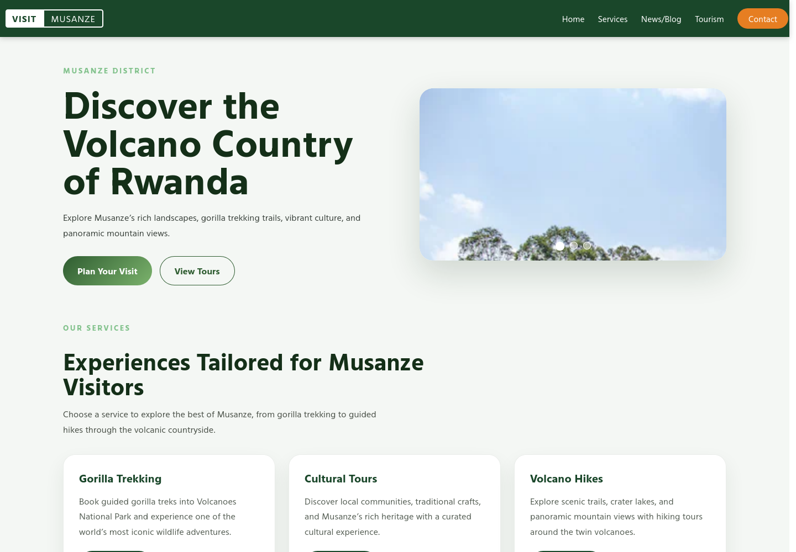
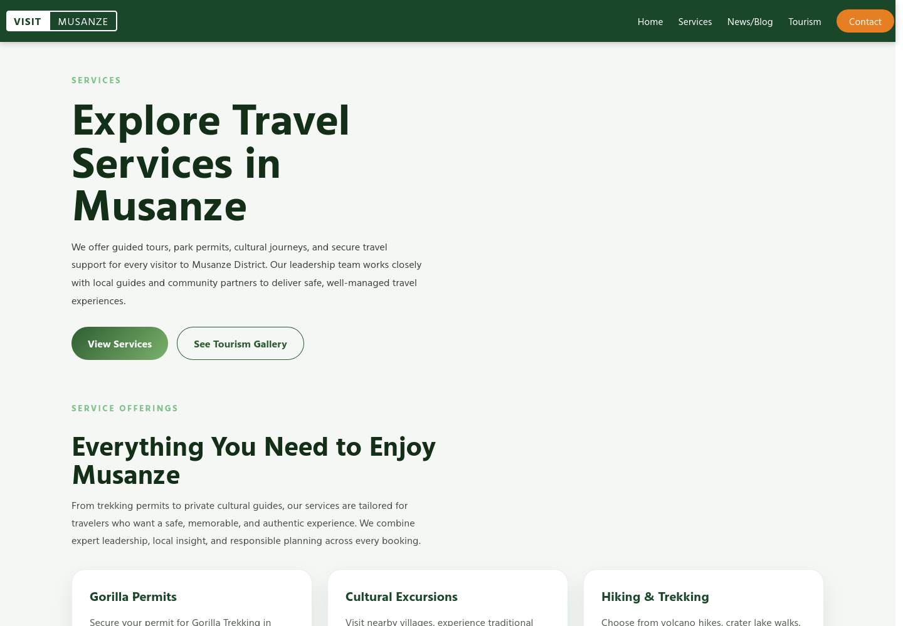
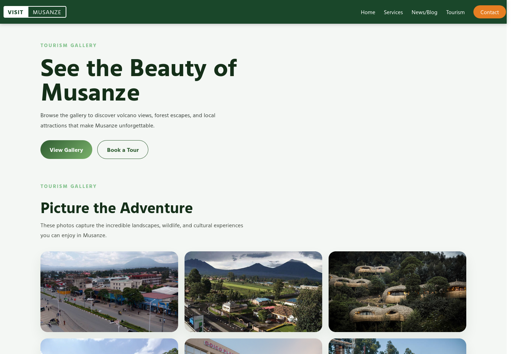

# Visit Musanze

A responsive, five-page tourism website for **Musanze District, Rwanda** — the gateway to Volcanoes National Park and mountain gorilla trekking.

Built as a dependency-free static site: plain HTML, CSS and a small amount of vanilla JavaScript. No build step, no framework, no backend.



## Pages

| Page | File | What it covers |
| --- | --- | --- |
| Home | `index.html` | Hero, auto-playing image slider, service highlights, latest articles |
| Services | `services.html` | Gorilla permits, cultural excursions, hiking and trekking, airport transfers |
| News & Blog | `news.html` | Updates, stories and community news |
| Tourism | `tourism.html` | Photo gallery of destinations across the district |
| Contact | `contact.html` | Contact details and a visitor enquiry form |

## Features

- **Shared layout** — the same navigation, footer and stylesheet across every page, so a change lands everywhere at once.
- **Hero slider** — auto-advances every 5 seconds, with clickable indicator dots for manual control.
- **Responsive grid layout** — hero, service cards, articles and gallery collapse from multi-column to single-column on mobile.
- **Micro-interactions** — hover lift on cards and a subtle zoom on gallery images.
- **Accessible navigation** — semantic landmarks (`header`, `nav`, `main`, `footer`) and `alt` text on every image.

## Screenshots

| Services | Tourism gallery |
| --- | --- |
|  |  |

## Project structure

```
.
├── index.html            Homepage (the only page with the slider)
├── services.html
├── news.html
├── tourism.html
├── contact.html
├── styles/
│   └── styles.css        Single stylesheet shared by all pages
├── scripts/
│   └── script.js         Slider logic; exits early on pages without a slider
├── assets/               Photography used across the site
└── docs/screenshots/     README images
```

## Run locally

The site works by opening `index.html` directly, but a local server is closer to how it will behave when deployed:

```bash
git clone https://github.com/tres9lo/visit-musanze.git
cd visit-musanze
python3 -m http.server 8000
# then open http://localhost:8000
```

Any static host (Netlify, Vercel, GitHub Pages, Cloudflare Pages) can serve the repository root with no configuration.

## Notes and limitations

- The contact form is **presentation only** — it has no `action` handler and does not send anything. Wire it to a form endpoint (Formspree, Netlify Forms, or your own API) before going live.
- Copy and photography are illustrative sample content for Musanze District; confirm details such as permit pricing and contact numbers before publishing.
- There is no active-page highlight in the navigation yet.

## Built with

HTML5 · CSS3 (Grid, Flexbox, custom properties) · vanilla JavaScript

## Author

**Bikorimana Ange Tresor** — [@tres9lo](https://github.com/tres9lo) · [tresor-dev.netlify.app](https://tresor-dev.netlify.app)

## License

[MIT](LICENSE)
